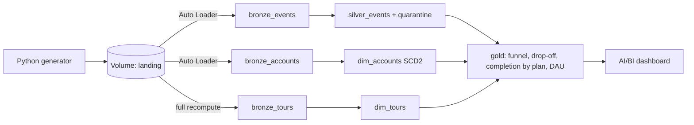

# Product Tours Analytics Lakehouse

A learning pet project on **Databricks Free Edition**: an end-to-end lakehouse pipeline that answers
product questions about in-app product tours:

- Which tours do users complete, and where do they drop off?
- How does tour completion differ by account plan (free / pro / enterprise)?
- Do tours influence upgrades to paid plans? *(planned extension)*

> All data is **synthetic**, produced by a deterministic generator in this repo. No real company data is used.

## Architecture



Medallion layers are built with **Lakeflow Spark Declarative Pipelines** (SQL), orchestrated by **Lakeflow Jobs**.

## Data sources

| Source | Format | Content | Built-in data issues |
|---|---|---|---|
| `events` | JSON lines, one file per day | tour events with nested `properties` (device, page, locale) | duplicates, late events, missing `user_id`, unknown `event_type`, malformed lines, new column `experiment_variant` from day 3 |
| `accounts` | CSV, daily changes | `account_id`, `plan`, `company_size`, `updated_at` | plan changes over time (SCD Type 2) |
| `tours` | CSV, reference file | `tour_id`, `tour_name`, `total_steps` | file is overwritten in place |

## Repository structure

```
├── src/generator.py                  # deterministic synthetic data generator
├── notebooks/00_generate_data        # writes N days of data to the landing volume
└── pipelines/transformations/
    └── bronze.sql                    # bronze streaming tables + reference MV
```

## How to run

1. Create the schema and volume:
   `CREATE SCHEMA workspace.product_tours; CREATE VOLUME workspace.product_tours.landing;`
2. Run `notebooks/00_generate_data` (widgets: `start_date`, `n_days`).
3. Create an ETL pipeline with root folder `pipelines/`, catalog `workspace`, schema `product_tours`, and run it.

## Design decisions

- **Deterministic generator.** Each day uses `random.Random(day.toordinal())` as a seed, so regenerating a day
  produces identical files. Reruns are idempotent and test data is reproducible.
- **Bronze is raw and append-only.** Duplicates and malformed rows are kept on purpose: Silver can be rebuilt
  from Bronze if transformation logic changes, without re-requesting source data. Each row keeps
  `source_file` and `ingested_at` for lineage.
- **Streaming table vs materialized view.** Events and account changes arrive as new files, so Bronze uses
  Auto Loader streaming tables (each file is processed once). `tours.csv` is overwritten under the same name,
  which Auto Loader ignores by default, so it is a materialized view with full recompute (cheap for a small reference table).
- **Materialize raw data before validating it.** Querying raw JSON directly gave inconsistent results for malformed
  rows: `WHERE event_id IS NULL` returned 0 rows while `WHERE account_id IS NULL` returned 3, because JSON filter
  pushdown evaluates predicates mid-parse. The same filter on the Bronze Delta table is deterministic.
- **Reconciliation.** Bronze row counts per file are checked against the source files read as plain text.
- **Event time ≠ ingestion time.** Late events land in the next day's file, so aggregates are based on `event_ts`,
  not on file date.

## Roadmap

- [x] Synthetic data generator with realistic data issues
- [x] Bronze layer (Auto Loader, rescued data, source metadata)
- [ ] Silver: parsing, expectations, quarantine, deduplication, SCD2 accounts (AUTO CDC)
- [ ] Gold: tour funnel, step drop-off, completion by plan, DAU
- [ ] AI/BI dashboard
- [ ] Lakeflow Job: generate → pipeline → quality checks → log
- [ ] Unit tests (pytest) and GitHub Actions CI
- [ ] Declarative Automation Bundle with dev/prod targets
- [ ] Extension: purchases and tour-to-upgrade conversion

## Tech stack

Databricks (Free Edition) · Delta Lake · Unity Catalog · Lakeflow Declarative Pipelines · Auto Loader ·
PySpark · SQL · Git folders · GitHub
